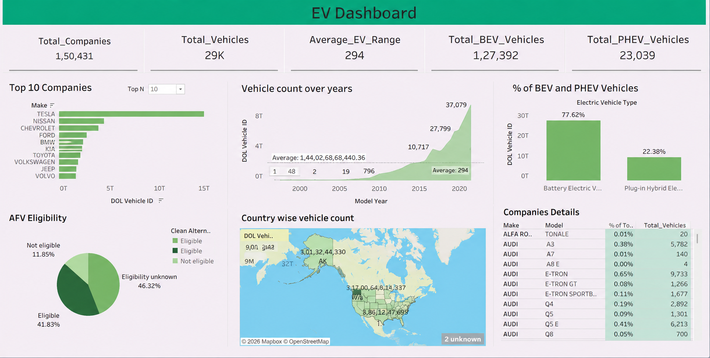

# Electric Vehicle Market Analysis | Tableau Dashboard

An interactive Tableau dashboard built around an electric vehicle registration dataset. This repository presents the existing workbook and its accompanying dataset for portfolio review.

## Dashboard preview



The image is a static preview. Open the packaged workbook in Tableau to explore the dashboard interactively.

## Project files

```text
.
├── dashboards/
│   └── ev_market_dashboard.twbx      # Packaged Tableau workbook
├── data/
│   └── ev_population_dataset.xlsx     # Dataset supplied with the project
├── images/
│   └── dashboard_preview.png          # Static dashboard preview
└── README.md
```

## Open the dashboard

1. Download or clone this repository.
2. Open `dashboards/ev_market_dashboard.twbx` in Tableau Desktop.
3. Use the dashboard controls to explore the views. The packaged workbook is provided as-is; no scripts or separate setup steps are included.

The supplied dataset is available at [`data/ev_population_dataset.xlsx`](data/ev_population_dataset.xlsx) for reference.

## Dashboard views

The workbook includes views for manufacturer rankings, vehicle counts by model year, BEV and PHEV share, alternative-fuel eligibility, geographic distribution, and manufacturer/model details.

